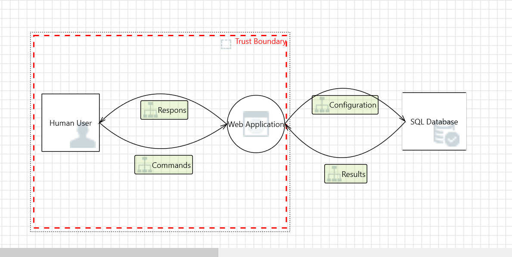
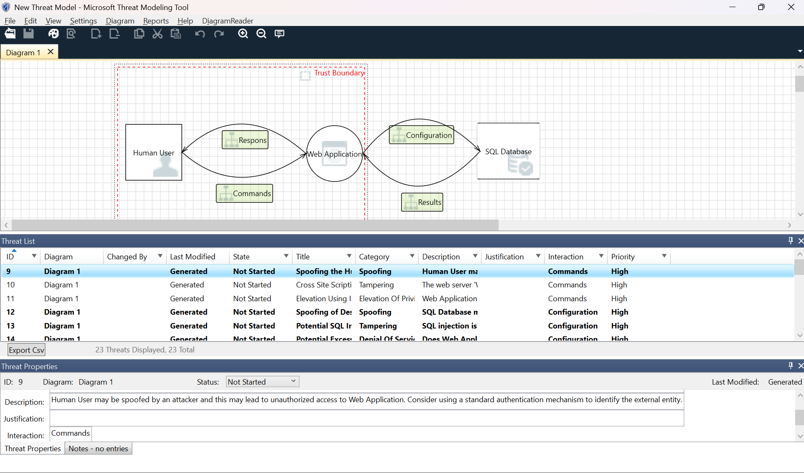

# ITSI_Aufgaben 

### Name: Volodymyr Shchyrov
### Klasse: 3CHIT

## Task 01 - Grundlagen

**Schritt 1: Tool kennenlernen**

Man wählt Template für den Model.
Ich habe `SDL Knowledge Base` gewählt.

Dann erstellen wir eine Model.

**Schritt 2: System modellieren**

In diesem Schritt modeliert man eine ***Datenflussdiagramm***.

Notwendige Elemente:
- Externe Entitäten (z. B. Kunde, Zahlungsanbieter)
- Prozesse (z. B. Webserver, Applikationsserver)
- Datenspeicher (Datenbank)
- Datenflüsse zwischen den Komponenten

`Trust Boundaries` - Das Threat-Modeling-Tool ermöglicht es Benutzern, Vertrauensgrenzen festzulegen – gekennzeichnet durch die roten gepunkteten Linien –, um zu veranschaulichen, wo verschiedene Entitäten die Kontrolle ausüben.

**Schritt 3: Bedrohungen analysieren**

**MTMT** stützt sich auf eine **SDL-Vorlage**, in der bereits ein bestimmter **Pool** vorhersehbarer Angriffe hinterlegt ist.
**Das System generiert diese Angriffe** und ermittelt, welche davon den Systembetrieb beeinträchtigen können.

Obere Fenster