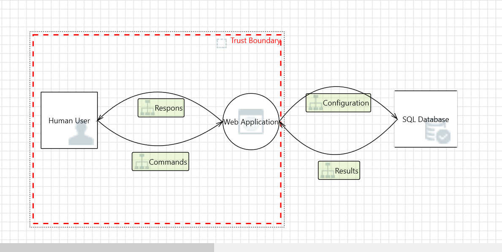
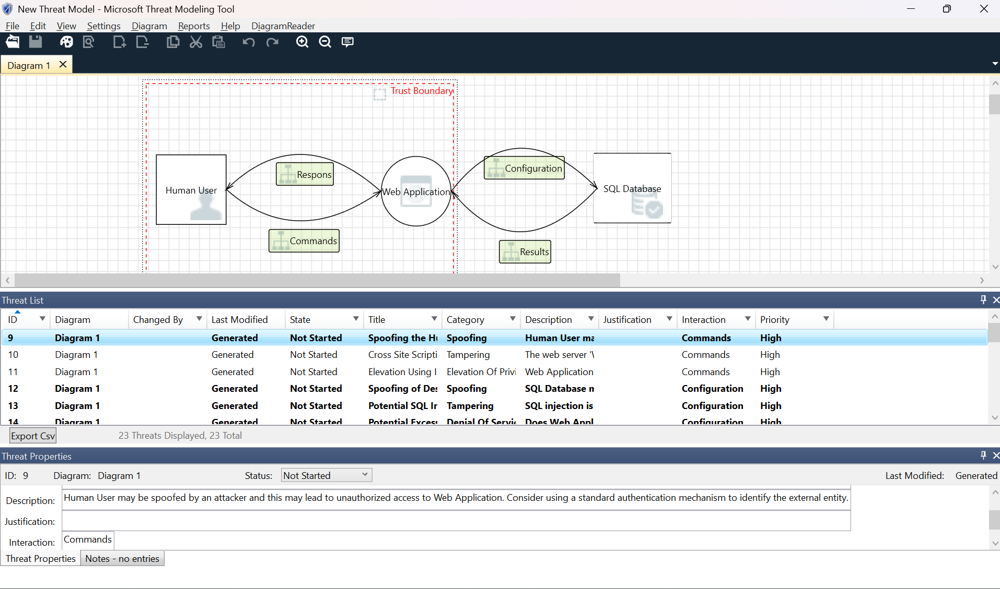

Link zum GitHub: [https://github.com/VolodyaShchyrov/ITSI_Repo](https://github.com/VolodyaShchyrov/ITSI_Repo)


# ***Task - Grundlagen*** 

`Name`: Volodymyr Shchyrov 

`Klasse`: 3CHIT

`Datum`: 09/10/26 


### **Teil 1 - Bedrohungsmodellierung mit dem Microsoft Threat Modeling Tool**

**Schritt 1: Tool kennenlernen**

Installieren wir zuerst das Programm ```Microsoft Threat Modeling tool```. Dannach erstellen wir eine neue Model mit einem bestimten Tamplate **SDL TM Knowledge Base**.


**Schritt 2: System modellieren**

Erstellen wir eine **Datenflussdiagramm (DFD)** Mit solche Objekte:

    - Externe Eintität
    - Prozesse
    - Datenspeicher
    - Datenflüsse




**Schritt 3: Bedrohungen analysieren**

Dieses Tool kann alle Bedrohungen automatish generieren und vorgeschlagene Risiken analyieren.



Wenn man bei **View => Analyses View** klickt, öffnet man eine Bedrohungsliste mit allen möglichen Bedrohungen.

Bei mir kommt auf einmal 31 Bedrohungen. Solche Bedrohungen wie: Spoofing, Elevation, SQL injection, Tampering, Denial Of Service.

Alle diese Bedrohungstypen steheN auf höherem Priorität, weil sie alle kritisch sein können.


**Schritt 4: Gegenmaßnahmen entwickeln**

|**Bedrohung**|**Risiko**|**Gegenmaßnahme**|
|-------------|----------|-----------------|
|Elevation Of Privilege|Eine SQL-Datenbank könnte unter Umständen die Remote-Ausführung von Code für eine Webanwendung ermöglichen.|Einschränkung der Datenbankrechte, Deaktivierung gefährlicher Funktionalitäten|
|Denial Of Service|Die Webanwendung stürzt ab, bleibt stehen, hält an oder läuft langsam – in all diesen Fällen wird ein Verfügbarkeitswert verletzt.|Lastverteilung, Time-out's, Überwachung und Alarmierung|
|Repudiation|Die Webanwendung gibt an, keine Daten von einer Quelle außerhalb der Vertrauensgrenze erhalten zu haben. Ziehen Sie den Einsatz von Protokollierung oder Auditierung in Betracht, um die Quelle, den Zeitpunkt sowie eine Zusammenfassung der empfangenen Daten zu erfassen.|Protokollierung, Auditing|


**Schritt 5: Reflexion**

1. Ich habe das Programm ```Microsoft Threat Modeling tool``` kennengelernt und wofür verwendet man dieses Programm.
2. Automatische Bedrohungskennung ist sehr hilfreich, weil dise System sehr viel zeit beim Bedrohungsuche speichert und dises Programm allgemein sehr angenehm zur Benutzung ist.
3. Es gab keine wesentliche Probleme, außer dass, das es genug Zeit verbraucht.


### **Teil 2 - Vulnerability Analyse**

**Setup:** 
- Webserver läuft als root
- /admin nur durch URL erreichbar (keine Auth)
- Debug-Modus aktiv
- .git-Ordner öffentlich zugänglich
- keine Input-Validierung bei Formularen
- keine TLS-Verschlüsselung

**Aufgabe 1:**

 - Webserver läuft als root: Access Control Failure / Improper Privilege Management (CWE-250: Execution with Unnecessary Privileges)

- /admin nur durch URL erreichbar (keine Auth): Access Control Failure (CWE-306: Missing Authentication for Critical Function)

- Debug-Modus aktiv: Misconfiguration / Information Leakage (CWE-489: Active Debug Code)

- .git-Ordner öffentlich zugänglich: Information Leakage (CWE-538: Insertion of Sensitive Information into Externally-Accessible File or Directory)

- Keine Input-Validierung bei Formularen: Injection (CWE-20: Improper Input Validation)

- Keine TLS-Verschlüsselung: Information Leakage / Cryptographic Issues (CWE-319: Cleartext Transmission of Sensitive Information)

**Aufgabe 2:**

1. Fehlende Authentifizierung im /admin-Bereich:

    - **Angriffsschritte**: Aufrufen von ```http://target.com/admin``` im Browser.

    - **Ziel**: Zugriff auf administrative Funktionen, Benutzerverwaltung und Systemsteuerung.

    - **Payload**: Keine komplexe Payload nötig, direkter URL-Aufruf reicht aus.

2. Offener .git-Ordner:

    - **Angriffsschritte**:: Automatisiertes herunterladen des .git-Verzeichnisses mittels Tools wie GitTools (git dumper).

    - **Ziel**: Rekonstruktion des Quellcodes, Auffinden von hardcodierten Passwörtern, API-Keys oder Datenbankzugangsdaten.

    - **Payload**: Zugriffssperre in der Webserver-Konfiguration.

3. Keine Input-Validierung (SQL Injection / XSS):

   - **Angriffsschritte**: Eingabe von SQL-Syntax in Login-Formular oder Suchmaske.

   - **Ziel**: Umgehung der Authentifizierung oder Ausführen von Skripten im Browser anderer Nutzer.

    - **Payload**: ' OR '1'='1

4. Webserver läuft als root:

    - **Angriffsschritte**: Kombination mit einer RCE-Schwachstelle (Remote Code Execution). Da der Webserver volle Root-Rechte besitzt, hat der Angreifer sofort die vollständige Kontrolle über das gesamte Betriebssystem.

   - **Ziel**: Volle Systemkompromittierung (Root-Access).

   - **Payload**: Systembefehle wie cat /etc/shadow oder Einrichten von Backdoors.

5. Aktiver Debug-Modus:

   - **Angriffsschritte**: Provozieren von Fehlern (z. B. durch falsche Parametereingaben).

    - **Ziel**: Auslesen von Stack Traces, Pfadnamen, Framework-Versionen und internen Systemvariablen zur Vorbereitung weiterer Angriffe.

    - **Payload**: Übergabe von ungültigen Datentypen an API-Endpunkte.
  
**Aufgabe 3:**


1. Kritischste Schwachstelle: Der als root laufende Webserver in Kombination mit fehlender Authentifizierung und Input-Validierung. Wenn ein Angreifer Code ausführen kann, besitzt er sofort die höchste Berechtigungsstufe im System.

2. Besonders gefährliche Kombination: Die Kombination aus offenem .git-Ordner (Quellcode-Analyse) + fehlender Input-Validierung + Root-Rechten führt zu einer ungesicherten Angriffsfläche, bei der ein Angreifer gezielt Schwachstellen im Code findet, ausnutzt und die vollständige Kontrolle über den Server erlangt.


### **Teil 3 - Sicherheitsprinzipien – Trade-offs**

#### **Szenario A:**

```Ein Unternehmen reduziert Features stark (Minimalprinzip), verliert aber wichtige Funktionalität.```

Unnötige Features, die nicht benötigt werden und für den Use Case nicht erforderlich sind, werden weggelassen.


#### **Szenario B:**
`Ein Entwickler setzt auf „versteckte URLs“ statt Authentifizierung.`

**Security by Obscurity** ist keine valide Sicherheitsstrategie, da die Geheimhaltung von Algorithmen oder URLs anfällig zu Enumeration oder Leaks ist.

Nach **Kerckhoffs’ Prinzip** muss die Sicherheit eines Systemes allein auf der Geheimhaltung des Schlüssels basieren, nicht aber auf der Unkenntnis des Systemdesignes oder der URLs.


#### **Szenario C:**

`Ein System läuft mit minimalen Rechten, aber komplexe Workarounds entstehen.`

Wenn das Prinzip **Least Privilege** zu starr oder unklar dokumentiert umgesetzt wird, neigen Admins oft dazu, aus Frust über Berechtigungsfehler übergroße Rechte zu vergeben.

### **Teil 4 - Fail-Open vs. Fail-Close – Systemdesign**

| System | Entscheidung | Technische & ethische Begründung | Worst-Case-Szenario |
| :--- | :--- | :--- | :--- |
| **Cloud-Authentifizierungsdienst** | **Fail-Close** | Wenn der Authentifizierungsdienst ausfällt, darf kein Zugriff gewährt werden. Die Integrität und Vertraulichkeit von Benutzerkonten und geschützten Ressourcen hat oberste Priorität. | Unbefugter Zugriff auf alle geschützten Systeme und Daten, da bei einem Dienstausfall pauschal jeder Nutzer reingelassen werden würde. |
| **Medizintechnisches Gerät (Notbetrieb)** | **Fail-Open (mit Einschränkungen)** | Bei lebenserhaltenden Geräten (z. B. Beatmungsgeräten oder Infusionspumpen) steht das Menschenleben im Vordergrund. Ein Systemabsturz durch strenge Sicherheits- oder Validierungsprüfungen darf den medizinischen Betrieb keinesfalls blockieren. | Das Gerät schaltet in den Notbetrieb, ignoriert dabei temporär bestimmte Sensorfehler, was im worst case zu einer fehlerhaften Dosierung oder Gerätefehlfunktion führen kann. |
| **Industriesteuerung (SCADA)** | **Fail-Close** | Die physische Sicherheit von Menschen und Umwelt steht an erster Stelle. Bei unklarem Systemzustand, Kommunikationsverlust oder erkannten Manipulationen muss die Anlage sofort in einen sicheren, stromlosen oder gestoppten Zustand übergehen. | Bei einer Fail-Open-Entscheidung könnte eine Fehlsteuerung Ventile unkontrolliert öffnen, Maschinen beschädigen oder im worst case zu schweren Personen- und Umweltschäden führen. |


### **Teil 5 - Disclosure-Strategie unter realen Bedingungen**


1. Bewertung der Disclosure-Strategien
   - No Disclosure: Gefährdet die Nutzer, da die Schwachstelle unbemerkt bleibt und von Kriminellen ausgenutzt werden kann.

   - Limited Disclosure: Weitergabe an ausgewählte Stellen (z. B. CERT), nützlich, aber ohne Fix oft unvollständig.

   - Full Disclosure: Sofortige Veröffentlichung aller Details. Setzt Hersteller unter Druck, gefährdet aber sofort alle ungepatchten Systeme.

   - Responsible Disclosure: Koordinierte Offenlegung (Vorgabe einer Frist an den Hersteller, z. B. 90 Tage, vor Veröffentlichung). Schützt Endnutzer am besten.


2. Eigene Strategie & Zeitplan (Schulportal-Beispiel)
    1. Interne Dokumentation der Schwachstelle.

    2. Kontaktaufnahme mit den IT-Verantwortlichen der Schule per verschlüsselter E-Mail mit detailliertem Report und Lösungsvorschlag. Setzen einer angemessenen Frist.

    3. Erinnerung und Unterstützung bei der Behebung.

    4. Nach erfolgreichem Patch: Öffentliche Bestätigung.


3. Ethische & rechtliche Risiken

Ethisch: Verantwortung gegenüber Mitschülern und Lehrern, deren private Daten gefährdet sind. Kein Ausnutzen der Daten zum eigenen Vorteil.

Rechtlich: In Österreich fällt unbefugter Zugriff auf Daten unter das Strafgesetzbuch. Daher niemals Daten herunterladen oder verändern, sondern nur zur Verifikation erstellen. 


### **Teil 6 – Schwachstellenmanagement nach BSI-Warnung**

**Schritt 1&2: Meldung & CVE-Recherche**

 - Technische Beschreibung: Apache Log4j bis Version 2.15.0 unterstützt JNDI-Lookups in Log-Nachrichten. Wenn Benutzereingaben geloggt werden, interpretiert Log4j Zeichenketten und lädt externen Code nach.

 - CVSS Score: 10.0 (Critical)

- Art der Schwachstelle: Remote Code Execution (RCE) / CWE-502 (Deserialization of Untrusted Data) & CWE-20 (Improper Input Validation).

- BSI-Meldung: Warnstufe Rot. Betrifft unzählige Java-basierte Enterprise-Anwendungen, Server und Bibliotheken weltweit.

**Schritt 3: Übertragung auf ein Unternehmen**

1. Log4j wird in fast jeder Java-basierten Software als Standard-Logging-Bibliothek verwendet (Frameworks wie Spring Boot, Apache Struts, Elasticsearch, etc.).

2. Besonders öffentlich erreichbare Webserver und ERP-Systeme, die HTTP-Header oder Formulareingaben direkt in Logdateien schreiben.

3. Probleme durch Drittsoftware: Unternehmen wissen oft gar nicht, welche Bibliotheken in ihrer gekauften oder Open-Source-Drittsoftware enthalten sind.

**Risikobewertung:**

| System | Risiko | Begründung | CIA-Ziel |
| :--- | :--- | :--- | :--- |
| **Webserver (Internet)** | **Kritisch** | Ist direkt aus dem Internet erreichbar. Angreifer können über HTTP-Anfragen (z. B. im User-Agent) leicht von außen RCE (Remote Code Execution) auslösen. | **Integrität & Verfügbarkeit** (Kompromittierung des gesamten Systems, Datenverlust oder Stillstand) |
| **internes ERP** | **Mittel bis Hoch** | Befindet sich meist im internen Netzwerk, verarbeitet aber oft auch Daten von außen oder von Mitarbeitern. Risiko steigt, wenn interne Angreifer oder kompromittierte Clients zugreifen können. | **Vertraulichkeit & Integrität** (Diebstahl von Geschäftsgeheimnissen oder Manipulation von Finanzdaten) |
| **Logging-System** | **Kritisch** | Das Logging-System verarbeitet *alle* eingehenden Strings und Fehlermeldungen direkt. Wenn es selbst Log4j nutzt oder ungeschützt ist, schlägt der Exploit dort unmittelbar fehlertolerant ein. | **Verfügbarkeit & Integrität** (Ausfall des Logs, Löschung oder Manipulation von Sicherheitsnachweisen) |

**Schritt 4: Maßnahmen**
- Kurzfristig: Setzen der JVM-Property -Dlog4j2.formatMsgNoLookups=true oder Entfernen der JndiLookup-Klasse aus dem Classpath.

- Mittelfristig: Aktualisieren der Log4j-Bibliothek auf Version 2.17.1 oder höher. Durchführen von Vulnerability Scans.

- Langfristig: Etablierung eines professionellen Software Asset Managements (SBOM) und automatisierter Dependency-Scanning-Tools in der CI/CD-Pipeline.

**Schritt 5: Lessons Learned**
Log4j wurde zur Schwachstelle, weil eine Logging-Bibliothek zu viel konnte (unnötige Features wie JNDI-Auflösung und dynamische Code-Ausführung implementiert hatte, statt reine Textprotokollierung zu betreiben).
